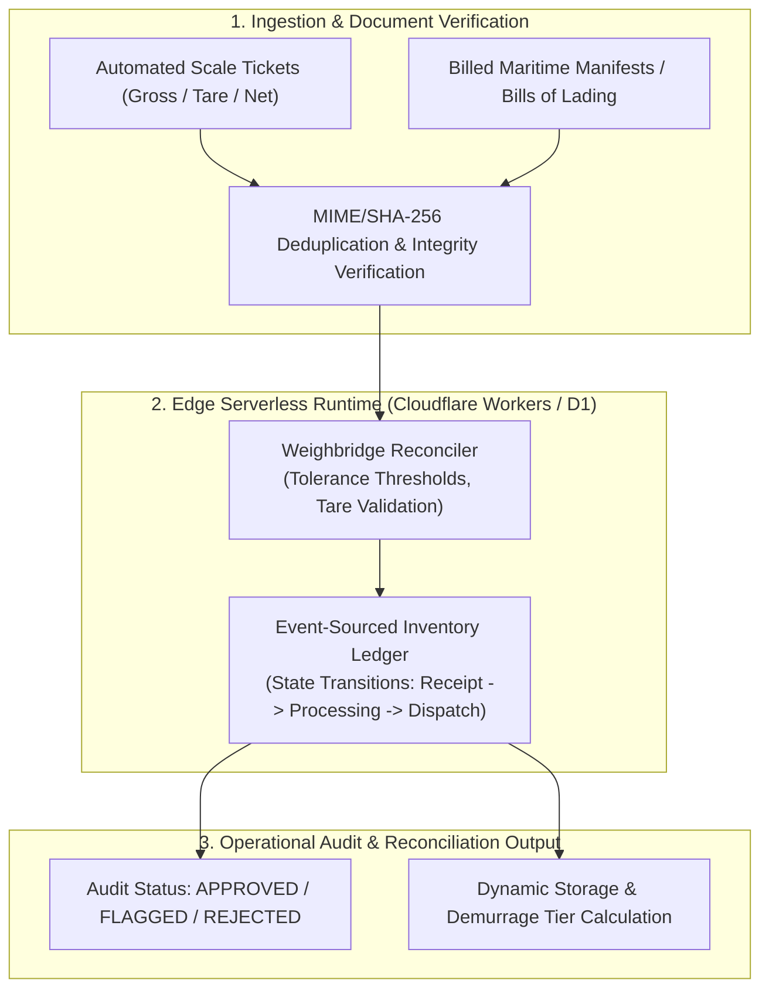

# ⚓ PortScale Reconcile Serverless
### *Edge-Native Weighbridge Reconciliation, Port Dispatch Allocation & Event-Sourced Industrial Inventory*

[](https://www.typescriptlang.org/)
[](https://workers.cloudflare.com/)
[](https://developers.cloudflare.com/d1/)
[]()
[]()

---

## 📌 Executive Summary

Industrial bulk logistics (alloys, grains, minerals, and chemicals) involves hundreds of truck scale dispatches per day between deepwater sea terminals and processing facilities. Discrepancies between **billed maritime manifests (Bills of Lading)** and **physical scale tickets** create severe inventory leakage, tax compliance penalties, and billing disputes.

`PortScale Reconcile Serverless` is a high-availability, edge-native reference architecture designed for **automated 24/7 weighbridge reconciliation, multi-tier freight assignment, and event-sourced inventory management**.

> 🔒 **Enterprise Sanitization Notice:**  
> This open-source implementation operates on **100% synthetic manifest and ticket data** (`scripts/generate-mock-data.js`). No proprietary maritime data, client tax IDs (CNPJ), or port infrastructure credentials are included.

---

## 🏗️ Architecture Topology



---

## 🔬 Core Engineering Features

1. **Deterministic Scale Ticket Integrity:** Validates that $Net = Gross - Tare$ strictly within scale calibration variance ($\pm 1.0\text{ kg}$). Catches scale drift and operator tampering.
2. **Tolerance-Bounded Batch Reconciliation:** Evaluates cumulative shipment tonnage against maritime manifests within contract tolerances (e.g. $\pm 0.5\%$). Automatically flags anomalous deliveries for manual survey audit.
3. **Event-Sourced State Transitions:** Guarantees non-negative inventory balances through explicit state machine transitions (`PORT_RECEIPT` $\rightarrow$ `PROCESSING` $\rightarrow$ `DISPATCH_SALE`).
4. **Zero Cold-Start Edge Execution:** Designed to execute within Cloudflare Workers sub-50ms latency profiles worldwide.

---

## 🚀 Quickstart

### 1. Installation & Build
```bash
# Clone the repository
git clone https://github.com/wenderson-werneck/portscale-reconcile-serverless.git
cd portscale-reconcile-serverless

# Compile TypeScript
npm run build
```

### 2. Generate Synthetic Benchmark Data
```bash
npm run generate:data
```

### 3. Run Automated Tests
```bash
node --test dist/**/*.test.js
```

*Test Output:*
```text
✔ WeighbridgeReconciler: accurately approves batches within tolerance (0.63ms)
✔ WeighbridgeReconciler: flags batches exceeding operational tolerance (0.16ms)
✔ IndustrialInventoryLedger: enforces strict non-negative state transitions (0.39ms)
ℹ tests 3
ℹ pass 3
ℹ fail 0
```

---

## 📂 Project Structure

```text
portscale-reconcile-serverless/
├── data/                      # Synthetic manifests & scale tickets
├── scripts/
│   └── generate-mock-data.js  # Benchmark data generator
├── src/
│   ├── types.ts               # Domain data contracts & interfaces
│   ├── reconciliation.ts      # Weighbridge reconciliation engine
│   ├── inventory.ts           # Event-sourced inventory ledger
│   ├── index.ts               # Public library entrypoint
│   └── reconciliation.test.ts # Native automated test suite
├── package.json               # Package configuration
├── tsconfig.json              # TypeScript strict configuration
└── README.md                  # System architecture documentation
```

---

## 👤 Author
**Wenderson Soares (Werneck)**  
*Analytics Engineer | Data Platforms & Serverless Systems*  
[LinkedIn](https://www.linkedin.com/in/wendersonwerneck/) • [GitHub](https://github.com/wenderson-werneck)
